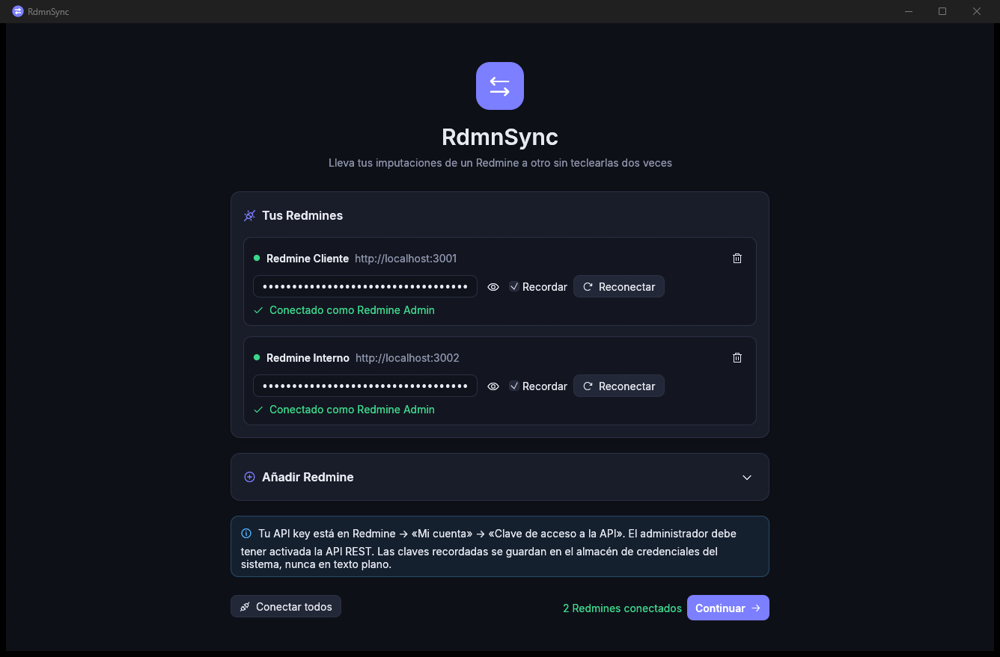
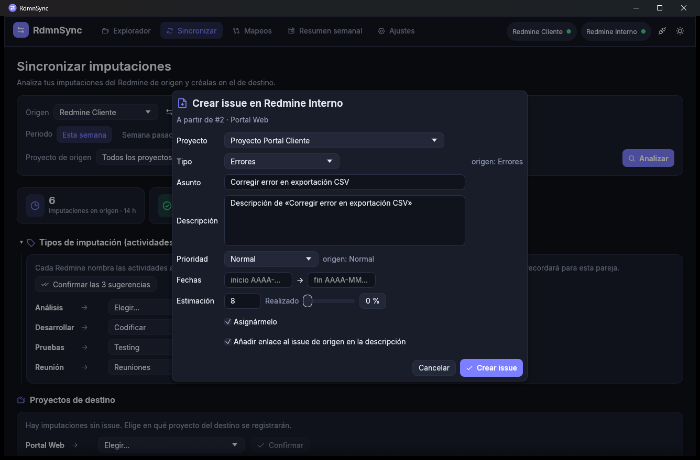

# Manual de uso de RdmnSync

Este manual explica, pantalla a pantalla, cómo usar RdmnSync para trasladar tus imputaciones de un
Redmine a otro. Si buscas cómo compilar o cómo está hecho por dentro, consulta el [README](README.md).

## Contenido

1. [Conceptos básicos](#1-conceptos-básicos)
2. [Antes de empezar](#2-antes-de-empezar)
3. [Instalación y primer arranque](#3-instalación-y-primer-arranque)
4. [Pantalla de conexiones](#4-pantalla-de-conexiones)
5. [La ventana principal](#5-la-ventana-principal)
6. [Explorador](#6-explorador)
7. [Sincronizar: guía paso a paso](#7-sincronizar-guía-paso-a-paso)
8. [Crear un issue en el destino](#8-crear-un-issue-en-el-destino)
9. [Igualar los issues de destino](#9-igualar-los-issues-de-destino)
10. [Mapeos](#10-mapeos)
11. [Resumen semanal](#11-resumen-semanal)
12. [Ajustes](#12-ajustes)
13. [Flujo de trabajo recomendado](#13-flujo-de-trabajo-recomendado)
14. [Solución de problemas](#14-solución-de-problemas)
15. [Preguntas frecuentes](#15-preguntas-frecuentes)
16. [Glosario](#16-glosario)

---

## 1. Conceptos básicos

| Término | Significado en RdmnSync |
|---|---|
| **Origen** | El Redmine del que se **leen** las imputaciones. Nunca se modifica. |
| **Destino** | El Redmine en el que se **crean** las imputaciones (y, opcionalmente, se actualizan issues). |
| **Imputación** | Un registro de horas (*time entry*): fecha, horas, actividad, comentario y, normalmente, un issue. |
| **Actividad** | El tipo de imputación: «Desarrollo», «Pruebas», «Reunión»… Cada Redmine tiene las suyas. |
| **Mapeo** | Una correspondencia aprendida entre algo del origen y algo del destino (una actividad, un proyecto, un issue, un estado o una versión). |
| **Pareja** | Un origen y un destino concretos, en ese orden. Los mapeos se guardan por pareja: lo aprendido para *Cliente → Interno* no se aplica a *Interno → Cliente*. |

La idea general: **la app hace lo que puede sola y te pregunta lo que no tiene claro**. Lo que
confirmas se guarda, así que cada semana tendrás que intervenir menos.

## 2. Antes de empezar

### 2.1. Obtener tu API key

En **cada** Redmine que quieras usar:

1. Inicia sesión en la web de Redmine.
2. Abre **Mi cuenta** (arriba a la derecha).
3. En el panel lateral derecho, busca **Clave de acceso a la API** y pulsa **Mostrar**.
4. Copia la clave (una cadena de 40 caracteres).

> Si no ves la sección «Clave de acceso a la API», el servicio REST está desactivado. Un
> administrador debe activarlo en *Administración → Configuración → API → Activar servicio web REST*.

La API key te identifica: **todo lo que haga RdmnSync se hará en tu nombre** y con tus permisos.
Trátala como una contraseña.

### 2.2. Permisos necesarios

| Para… | Necesitas en el Redmine correspondiente |
|---|---|
| Ver proyectos, issues e imputaciones | Ser miembro del proyecto con permiso de ver issues e imputaciones |
| Crear imputaciones en el destino | Permiso «Imputar tiempo» en el proyecto de destino |
| Crear issues en el destino | Permiso «Añadir peticiones» |
| Igualar issues de destino | Permiso «Editar peticiones» y que el flujo de trabajo permita las transiciones de estado |
| Deshacer una sincronización | Permiso para borrar tus propias imputaciones |

## 3. Instalación y primer arranque

1. Descarga el binario desde la página de
   [releases](https://github.com/lunasvalle02-design/RdmnSyncV2/releases/latest):
   - **Windows**: `rdmnsync-windows-x64.exe`. Si aparece «Windows protegió su PC», pulsa
     *Más información → Ejecutar de todas formas* (el binario no está firmado).
   - **Linux**: `rdmnsync-linux-x64`. Dale permisos de ejecución con `chmod +x rdmnsync-linux-x64`.
2. Ejecútalo. No requiere instalación: puedes guardarlo donde quieras.
3. La primera vez se abre la **pantalla de conexiones**.

La aplicación recuerda el tamaño y la posición de la ventana entre sesiones.

## 4. Pantalla de conexiones

Es la primera pantalla y la puerta de entrada: **no puedes usar la app sin al menos una conexión
válida**, y para sincronizar necesitas dos.

### 4.1. Añadir un Redmine

En la tarjeta **Añadir Redmine** (si está plegada, pulsa la flecha de la derecha):

| Campo | Qué poner |
|---|---|
| **Nombre** | Un nombre corto para reconocerlo: «Redmine Cliente», «Interno»… Se usa en toda la app. |
| **URL** | La dirección base del Redmine, p. ej. `https://redmine.empresa.com`. Si omites `https://`, se añade. Si Redmine está en una subruta, inclúyela: `https://empresa.com/redmine`. |
| **API key** | La clave obtenida en el [paso 2.1](#21-obtener-tu-api-key). |
| **Recordar la API key en este equipo** | Guarda la clave en el almacén de credenciales del sistema para conectarse sola en el próximo arranque. |
| **Aceptar certificados no válidos** | Solo para Redmines internos con certificados autofirmados. Desactiva la verificación TLS: úsalo solo en redes de confianza. |

Pulsa **Añadir y conectar**. En unos segundos verás:

- 🟢 **Conectado como *Tu Nombre*** si todo ha ido bien.
- 🔴 Un mensaje de error si algo falla (ver [Solución de problemas](#14-solución-de-problemas)).

> El nombre del Redmine genera un identificador interno (p. ej. «Redmine Cliente» → `redmine-cliente`)
> que se usa en la marca `[sync:redmine-cliente#123]`. Ese identificador **no cambia** aunque
> después edites cosas, para no romper la detección de duplicados.

### 4.2. Gestionar los Redmines configurados

Cada Redmine de la lista **Tus Redmines** muestra:

- Un punto de estado: gris (sin conectar), amarillo (conectando), verde (conectado) o rojo (error).
- El campo de **API key**, con el botón 👁 para mostrarla u ocultarla. Pulsar Intro dentro del campo
  equivale a **Conectar**.
- **Recordar**: activa o desactiva el guardado de la clave. Al desactivarlo, la clave se borra del
  almacén del sistema.
- **Conectar / Reconectar**: valida la clave y carga tus proyectos, actividades, estados y prioridades.
- 🗑 **Eliminar**: quita el Redmine, su clave guardada y **todos los mapeos** en los que participa.

**Conectar todos** conecta de una vez los que aún no lo estén. **Continuar** lleva a la ventana
principal (se activa con al menos una conexión).

Puedes volver a esta pantalla en cualquier momento con el icono 🔌 de la barra superior o desde
*Ajustes → Gestionar conexiones*.

## 5. La ventana principal

La barra superior contiene:

- **Pestañas**: Explorador, Sincronizar, Mapeos, Resumen semanal y Ajustes.
- **Chips de conexión** a la derecha: cada Redmine conectado, con su punto verde. Pasa el ratón por
  encima para ver con qué usuario.
- 🔌 **Gestionar conexiones** y ☀/🌙 **cambiar tema**.
- Un indicador giratorio cuando hay operaciones de red en curso.

Las notificaciones (éxitos, avisos y errores) aparecen abajo a la derecha y desaparecen solas; puedes
cerrarlas con ✕.

## 6. Explorador

Sirve para consultar, sin modificar nada, tus proyectos, issues e imputaciones de cualquier Redmine
conectado.

### 6.1. Panel izquierdo: Redmine y proyectos
- Elige el Redmine en las píldoras de **REDMINE**.
- Busca un proyecto escribiendo en **Buscar proyecto** (ignora mayúsculas y acentos).
- Los subproyectos aparecen sangrados bajo su padre. Pasa el ratón por encima para ver el nombre
  completo o el proyecto padre.
- Haz clic en un proyecto para ver sus issues.

### 6.2. Panel central: issues
- **Asignados a mí** (activado por defecto): solo tus issues. Desactívalo para ver todos.
- **Incluir cerrados**: añade los issues cerrados.
- **Filtrar por asunto o número**: filtra la lista ya cargada al instante.
- ⟳ **Recargar** vuelve a pedir los datos al servidor.

La tabla muestra número, tipo, asunto, estado, prioridad y barra de progreso. Haz clic en una fila
para abrir el detalle.

### 6.3. Panel derecho: detalle del issue
- Tipo, número y estado; **Abrir** abre el issue en el navegador.
- Proyecto, prioridad, asignado, autor, fechas, horas estimadas y dedicadas, campos personalizados
  con valor y barra de % realizado.
- Descripción completa.
- **Imputaciones** del issue con fecha, usuario, actividad, horas y comentario (pasa el ratón para
  verlo entero), y el total. **Solo las mías** filtra por tu usuario.
- ✕ cierra el panel.

## 7. Sincronizar: guía paso a paso

### 7.1. Configurar el análisis

| Control | Uso |
|---|---|
| **Origen** | Redmine del que se leen tus imputaciones. |
| ⇄ | Intercambia origen y destino. |
| **Destino** | Redmine donde se crearán. No puede ser el mismo que el origen. |
| **Periodo** | *Esta semana*, *Semana pasada*, *Este mes*, *Mes pasado*, o escribe las fechas en formato `AAAA-MM-DD`. |
| **Proyecto de origen** | Limita el análisis a un proyecto. Por defecto, todos. |

Pulsa **Analizar**. La app lee tus imputaciones del origen y busca equivalencias en el destino. Al
terminar verás cuatro indicadores:

- **imputaciones en origen** (y horas totales),
- **listas para enviar** (y sus horas),
- **requieren tu atención**,
- **ya sincronizadas**.

Debajo aparecen, solo si hacen falta, las secciones que necesitan tu decisión. **Resuélvelas de arriba
abajo**: cada confirmación puede desbloquear filas de la tabla.

### 7.2. Tipos de imputación (actividades)

Cada actividad del origen que aparece en tus imputaciones debe tener un equivalente en el destino.

- Si en el destino existe una con **el mismo nombre** (sin contar mayúsculas ni acentos), se mapea
  sola y se guarda.
- Si no, la app **sugiere** la más probable (conoce sinónimos como Desarrollar ≈ Codificar ≈
  Programar, Pruebas ≈ Testing ≈ QA, Reunión ≈ Reuniones ≈ Meeting…) y espera tu confirmación.
  Si no encuentra ninguna razonable, verás «Elegir…».

Qué hacer:
1. Revisa cada desplegable y cambia la sugerencia si no es correcta.
2. Pulsa **Confirmar** en cada fila, o **Confirmar las N sugerencias** para aceptarlas todas.

Las actividades ya mapeadas muestran «✓ Mapeado»; puedes cambiarlas desde el desplegable y el nuevo
valor se guarda al momento. La sección se pliega con el triángulo de su título.

> Las **reglas por comentario** (ver [10.2](#102-reglas-por-comentario)) tienen prioridad: si una
> regla aplica a una imputación, se usa la actividad de la regla.

### 7.3. Proyectos de destino

Aparece en dos casos:

- **Imputaciones sin issue** (imputadas directamente a un proyecto): elige en qué proyecto del destino
  registrarlas y pulsa **Confirmar**. Si la app puede deducirlo de tus issues enlazados, lo
  preselecciona y lo indica con «sugerido · N de M issues».
- **Sugerencias deducidas**: si la mayoría de los issues enlazados de un proyecto de origen están en
  un mismo proyecto del destino, la app propone ese mapeo. **Confirmar** lo guarda; **Ignorar** lo
  oculta hasta el próximo análisis.

Mapear proyectos no es obligatorio para las imputaciones con issue, pero ayuda: la app buscará issues
equivalentes en ese proyecto y lo usará por defecto al crear issues.

### 7.4. Issues por confirmar

Cada issue del origen que la app no ha podido emparejar con seguridad aparece en una tarjeta:

- Cabecera: número y asunto del issue de origen (enlace a la web), proyecto, horas imputadas y una
  etiqueta:
  - **Dudoso**: hay candidatos razonables, pero no lo bastante seguros.
  - **Sin equivalente claro**: ningún candidato supera el umbral; probablemente haya que crearlo.
- Hasta cinco **candidatos** del destino con su porcentaje de similitud. Pasa el ratón sobre el
  asunto para ver el motivo («asunto 76 % similar, asignado a ti»).

Opciones:

| Botón | Efecto |
|---|---|
| **Usar seleccionado** | Enlaza con el candidato marcado y guarda el enlace. |
| **Crear issue en destino** | Abre el [diálogo de creación](#8-crear-un-issue-en-el-destino). |
| **Nº de issue** + **Enlazar** | Enlaza con un issue concreto del destino aunque no esté entre los candidatos (escribe `123` o `#123`). |
| **Omitir** | No sincroniza las imputaciones de ese issue en este envío (no se guarda nada). |

Los issues que la app enlaza sola (por encima del 92 %) no aparecen aquí; los verás en la tabla con su
porcentaje y podrás cambiarlos (ver 7.6).

### 7.5. Actualizar issues de destino

Si la opción de igualar issues está activa, aparece esta sección. Se explica en detalle en el
[apartado 9](#9-igualar-los-issues-de-destino).

### 7.6. La tabla de imputaciones

Una fila por imputación del origen:

| Columna | Contenido |
|---|---|
| ☑ | Si se enviará. Puedes desmarcar las que no quieras trasladar. |
| **Fecha** | Día de la imputación (pasa el ratón para ver el día de la semana). |
| **Horas** | Horas imputadas. |
| **Issue origen** | Número y asunto; si no tiene issue, el proyecto. Pasa el ratón para ver el comentario. |
| **Issue destino** | El issue enlazado. Los enlaces automáticos muestran su porcentaje. El icono ⛓ (enlace roto) **deshace el enlace** para elegir otro: el issue vuelve a «Issues por confirmar». |
| **Actividad** | Origen → destino, o una sola si se llaman igual. «?» si falta mapearla. |
| **Estado** | Ver tabla siguiente. |

Estados posibles:

| Estado | Significado | Qué hacer |
|---|---|---|
| ✅ **Lista** | Se creará al enviar. | Nada. |
| ❓ **Falta mapear la actividad «X»** | La actividad no tiene equivalente confirmado. | Confírmala en 7.2. |
| ❓ **Issue de destino sin confirmar** | El issue está en «Issues por confirmar». | Resuélvelo en 7.4. |
| ❓ **Falta el proyecto de destino** | Imputación sin issue y sin proyecto de destino. | Confírmalo en 7.3. |
| ❓ **Issue omitido** | Pulsaste «Omitir» en su issue. | Vuelve a analizar si cambias de idea. |
| 🔗 **Ya sincronizada** | Ya existe en el destino (por la marca o el historial). | Nada; no se volverá a crear. |
| ⚠ **¿Duplicada?** | En el destino hay una imputación con el mismo día, horas e issue, aunque sin marca. Se desmarca por defecto. | Márcala solo si de verdad quieres crearla otra vez. |
| **No se enviará** | La desmarcaste. | — |
| ✅ **Creada #N** | Creada en este envío. | — |
| ⚠ **Error** | Redmine la rechazó; el motivo aparece al lado. | Ver [Solución de problemas](#14-solución-de-problemas). |

**Ocultar ya sincronizadas** limpia la tabla de lo que ya está hecho.

### 7.7. Enviar

En el pie de la página:

- **Igualar también los issues de destino con los de origen**: activa o desactiva la actualización de
  issues para este y los próximos envíos.
- Un recordatorio de si se añadirá la marca `[sync:…]` al comentario.
- El botón de envío resume lo que hará, p. ej. «**Crear 4 imputaciones (8.5 h) y actualizar 2 issues**».
  Está desactivado si no hay nada listo.

Al pulsarlo:

1. Se crean las imputaciones, una a una, en el destino.
2. Después se actualizan los issues de destino (si procede).
3. Una barra muestra el progreso: hechas, correctas, issues actualizados y errores.
4. Al terminar, una notificación resume el resultado. Las filas pasan a «Creada #N» o «Error».

Cada envío queda registrado en el **historial** (ver [10.7](#107-historial-de-sincronizaciones)) y
puede deshacerse.

#### Qué se copia en cada imputación

| Dato | En el destino |
|---|---|
| Fecha y horas | Idénticas. |
| Actividad | La mapeada, buscada por nombre **dentro del proyecto de destino**. |
| Issue | El enlazado (o, si no tiene issue, el proyecto de destino). |
| Comentario | El original más la marca `[sync:<origen>#<id>]` si está activada. Se recorta a 1024 caracteres si hace falta. |
| Usuario | Tú (el dueño de la API key del destino). |

## 8. Crear un issue en el destino

Se abre con **Crear issue en destino** desde una tarjeta de «Issues por confirmar». Todos los campos
vienen precargados a partir del issue de origen:

| Campo | Precarga | Notas |
|---|---|---|
| **Proyecto** | El proyecto mapeado, el del mejor candidato o el de nombre más parecido. | Al cambiarlo se recargan los tipos y campos personalizados. |
| **Tipo** | Mapeo guardado de tipos, o el de nombre más parecido. | Se muestra el tipo de origen al lado como referencia. |
| **Asunto** y **Descripción** | Copiados del origen. | Editables. |
| **Prioridad** | Mapeo guardado, la de nombre parecido o la predeterminada. | «Por defecto» deja que Redmine decida. |
| **Fechas** | Inicio y fin del origen. | Formato `AAAA-MM-DD`. Vacío = sin fecha. |
| **Estimación** y **Realizado** | Copiados del origen. | Admite coma o punto decimal. |
| **Campos personalizados** | Los que usan los issues de ese proyecto y tipo, rellenos con los valores del origen que se llamen igual. | Para campos múltiples, separa los valores con comas. |
| **Asignármelo** | Activado. | Te asigna el issue. |
| **Añadir enlace al issue de origen** | Activado. | Añade «Origen: URL» al final de la descripción, lo que permite reconocer la correspondencia con un 100 % de seguridad en el futuro. |

Pulsa **Crear issue**. Si Redmine rechaza los datos (por ejemplo, falta un campo obligatorio), el
error aparece en el propio diálogo para que lo corrijas. Al crearse, el issue queda enlazado, y se
guardan los mapeos de proyecto, tipo y prioridad usados.

## 9. Igualar los issues de destino

Con la opción activada (lo está por defecto), cada issue de destino enlazado se pone al día con los
datos de su issue de origen. **Solo se modifica el issue de destino**; el de origen únicamente se lee.

### 9.1. Qué campos se igualan

Se configuran en *Ajustes → Actualización de issues de destino*:

| Campo | Por defecto | Cómo se traduce |
|---|---|---|
| Estado | ✅ | Por nombre o por el mapeo de estados. |
| % realizado | ✅ | Directo. |
| Fechas de inicio y fin | ✅ | Directo (también se vacían si en el origen no hay). |
| Estimación | ✅ | Directo. |
| Versión prevista | ✅ | Por el mapeo de versiones o por nombre dentro del proyecto de destino. |
| Prioridad | ⬜ | Por nombre o por el mapeo de prioridades. |
| Asunto | ⬜ | Directo. |
| Descripción | ⬜ | Directo, conservando el pie «Origen: …» si existe. |

### 9.2. La sección «Actualizar issues de destino»

- **Estados sin equivalente en el destino**: si un estado del origen no existe con el mismo nombre en
  el destino («En curso» frente a «En progreso»), elige el equivalente y pulsa **Confirmar**. Se
  guarda para la pareja.
- **Versiones sin equivalente en el destino**: igual, eligiendo entre las versiones del proyecto de
  destino del issue. Si la versión no existe, créala en Redmine y vuelve a analizar.
- **Lista de issues con cambios**: para cada uno, `#origen → #destino` y los campos que cambiarán con
  el valor actual ~~tachado~~ → el nuevo. Desmarca la casilla de un issue para no actualizarlo en este
  envío.
- «N issues de destino ya están al día»: no requieren cambios.

Si un campo está pendiente (por ejemplo, un estado sin mapear), los demás campos del issue sí se
envían; el pendiente se aplicará cuando lo resuelvas.

### 9.3. Respetar los cambios hechos en el destino

Activado por defecto (*Ajustes → Respetar los cambios hechos directamente en el destino*).

La app recuerda qué valores tenía el origen la última vez que igualó cada issue. Si un campo **no ha
cambiado en el origen** desde entonces, no se toca aunque alguien lo haya modificado en el destino.
Así no deshaces el trabajo de otras personas en el Redmine de destino.

Ejemplo: sincronizaste con «% realizado 50». Un compañero lo sube a 80 en el destino. Mientras en el
origen siga en 50, la app no lo bajará. Si en el origen pasa a 60, entonces sí se enviará 60.

Desactívalo si quieres que el origen mande siempre.

### 9.4. Campos que Redmine no aplica

Redmine ignora sin dar error algunos cambios, por ejemplo una transición de estado que tu rol no
tiene permitida en el flujo de trabajo, o el % realizado cuando se calcula a partir del estado. La
app vuelve a leer el issue tras actualizarlo y, si algo no se aplicó, muestra un aviso
«Redmine no aplicó en #N: Estado…». Esos campos se reintentarán en el siguiente envío.

## 10. Mapeos

Aquí ves y editas todo lo que la app ha aprendido. Elige arriba la pareja **Origen → Destino**: cada
dirección tiene sus propios mapeos. Para editar con desplegables, ambos Redmines deben estar
conectados; si no, la información se muestra en modo lectura.

### 10.1. Actividades
Lista de «actividad de origen → actividad de destino». Cambia el destino con el desplegable o borra el
mapeo con 🗑 (se volverá a preguntar). **Añadir** permite crear mapeos por adelantado.

### 10.2. Reglas por comentario
Fuerzan la actividad de destino cuando el comentario de la imputación **contiene** un texto (sin
distinguir mayúsculas ni acentos). Ejemplos:

| Si contiene | Usar |
|---|---|
| `reunión` | Reuniones |
| `daily` | Reuniones |
| `code review` | Revisión |

Se evalúan en orden y gana la primera que coincida. Tienen prioridad sobre el mapeo de actividades.

### 10.3. Proyectos
Correspondencias «proyecto de origen → proyecto de destino». Se usan para imputaciones sin issue, para
buscar issues equivalentes y como proyecto por defecto al crear issues. Puedes editarlas, borrarlas o
añadirlas (el desplegable de origen solo ofrece proyectos aún no mapeados).

### 10.4. Estados
Solo hace falta mapear los estados que **se llaman distinto**; los idénticos se emparejan solos. La
tarjeta avisa de los estados del origen que no tienen equivalente («Sin equivalente: En curso»).

### 10.5. Versiones
1. Elige un **proyecto de cada Redmine** para cargar sus versiones.
2. Elige una versión de origen y su equivalente en el destino, y pulsa **Guardar**.
3. O pulsa **Emparejar N por nombre** para mapear de una vez todas las que se llaman igual.

Las versiones cerradas o bloqueadas se indican entre paréntesis. Ten en cuenta que Redmine no permite
asignar issues a versiones cerradas.

### 10.6. Issues enlazados
Todos los enlaces «issue de origen → issue de destino», con su procedencia:

- **Confirmado**: lo elegiste tú.
- **Creado**: la app creó el issue de destino.
- **Automático**: emparejado por la app con alta confianza y usado en un envío.

Usa el filtro para buscar por asunto o número y ⛓ para **desenlazar** (la próxima vez se volverá a
buscar su equivalente).

### 10.7. Historial de sincronizaciones
Cada envío aparece con su fecha y hora, número de imputaciones, horas y rango de fechas.

**Deshacer** borra del destino todas las imputaciones creadas en ese envío (requiere el destino
conectado). Si alguna ya no existe, se considera deshecha.

> ⚠ Deshacer **solo borra imputaciones**. No revierte los cambios hechos al igualar issues ni borra
> los issues creados; esos cambios debes revertirlos a mano en Redmine si fuera necesario.

## 11. Resumen semanal

Muestra tus horas por día en cada Redmine conectado:

- ◀ ▶ cambian de semana; **Hoy** vuelve a la actual; ⟳ recarga.
- Cada celda tiene una barra proporcional a las horas del día.
- **Diferencia**: ✓ si todos coinciden, o «± N h» si no.
- Sábados y domingos aparecen atenuados.
- **Sincronizar esta semana** abre la pestaña Sincronizar con ese rango de fechas.

Úsalo como comprobación final del viernes: si todo está en ✓, has terminado.

## 12. Ajustes

| Sección | Opción | Por defecto |
|---|---|---|
| Apariencia | Tema **Oscuro** o **Claro** | Oscuro |
| Sincronización | Añadir la marca `[sync:origen#id]` al comentario en el destino | Activado |
| Sincronización | Emparejar issues sin preguntar desde… | 92 % |
| Sincronización | Proponer candidatos desde… | 55 % |
| Actualización de issues de destino | Igualar los issues de destino al sincronizar | Activado |
| Actualización de issues de destino | Campos a igualar | Ver [9.1](#91-qué-campos-se-igualan) |
| Actualización de issues de destino | Respetar los cambios hechos directamente en el destino | Activado |
| Datos | Ruta del fichero de configuración y **Gestionar conexiones** | — |

**Sobre los umbrales**: subir el primero hace que la app pregunte más a menudo; bajarlo la hace más
autónoma (y más propensa a equivocarse). Por debajo del segundo, la app sugiere crear el issue. Una
referencia explícita (la URL del issue de origen en el de destino) siempre cuenta como 100 %.

**Sobre la marca**: desactivarla deja los comentarios limpios, pero la detección de duplicados
dependerá solo del historial local y de la comparación por día, horas e issue.

## 13. Flujo de trabajo recomendado

**La primera vez** (10-15 minutos):
1. Conecta ambos Redmines con *Recordar* activado.
2. En **Mapeos**, añade los proyectos que sepas que se corresponden y las reglas por comentario que
   uses a menudo.
3. Sincroniza **una semana** y resuelve todas las preguntas con calma.

**Cada semana** (1-2 minutos):
1. Abre la app (se conecta sola).
2. **Sincronizar → Esta semana → Analizar**.
3. Normalmente solo habrá que confirmar algún issue nuevo.
4. Envía y comprueba el **Resumen semanal**.

Consejos:
- Al crear issues desde la app, deja activado «Añadir enlace al issue de origen»: el emparejamiento
  futuro será inmediato.
- Si un enlace automático es incorrecto, deshazlo con ⛓ en la tabla *antes* de enviar.
- Sincroniza con regularidad: periodos cortos son más fáciles de revisar.

## 14. Solución de problemas

| Mensaje o síntoma | Causa probable | Solución |
|---|---|---|
| «API key inválida o API REST deshabilitada (401)» | Clave mal copiada o servicio REST desactivado. | Copia de nuevo la clave; pide al administrador que active la API REST. |
| «No tienes permisos para esta operación (403)» | Tu rol no permite la acción en ese proyecto. | Pide el permiso (ver [2.2](#22-permisos-necesarios)). |
| «Recurso no encontrado (404)» al conectar | URL incorrecta. | Revisa la URL; incluye la subruta si Redmine no está en la raíz. |
| «Error de red…» | Sin conexión, VPN apagada, proxy o certificado. | Comprueba la VPN; define `HTTPS_PROXY` si usas proxy; para certificados internos, instala la CA en el sistema o usa «Aceptar certificados no válidos». |
| «Redmine rechazó los datos (422): …» | Validación de Redmine (campo obligatorio, versión cerrada, periodo bloqueado, issue cerrado…). | El texto tras los dos puntos indica el motivo exacto. |
| «La actividad «X» no está habilitada en el proyecto de destino» | El proyecto tiene desactivada esa actividad. | Actívala en el proyecto o mapea otra actividad. |
| «Redmine no aplicó en #N: Estado» | El flujo de trabajo no permite esa transición a tu rol. | Cambia el estado a mano o pide al administrador que ajuste el flujo. |
| Un proyecto no aparece | No eres miembro, o es un proyecto archivado. | Pide que te añadan como miembro. |
| La app no recuerda las claves (Linux) | No hay servicio de secretos activo. | Instala o inicia GNOME Keyring o KWallet. |
| Aparece «¿Duplicada?» en algo nuevo | Coincide en día, horas e issue con una imputación existente del destino. | Si es legítima, márcala y envíala. |
| Un emparejamiento automático es erróneo | Asuntos muy parecidos entre issues distintos. | Deshazlo con ⛓ y elige el correcto; considera subir el umbral automático. |
| «No se pudo leer la configuración» al arrancar | El fichero JSON está dañado. | La app guarda una copia `.json.bak` junto al original y arranca con la configuración vacía. |

## 15. Preguntas frecuentes

**¿Modifica algo en el Redmine de origen?**
No. El origen solo se lee: ni imputaciones, ni issues, ni comentarios.

**¿Puedo sincronizar en ambos sentidos?**
Sí, pero son dos sincronizaciones independientes: usa ⇄ para invertir origen y destino. Los mapeos
de cada dirección se guardan por separado.

**¿Qué pasa si ejecuto la misma sincronización dos veces?**
Nada malo: las imputaciones ya enviadas aparecen como «Ya sincronizada» y no se vuelven a crear.

**¿Y si borro el fichero de configuración?**
Pierdes los mapeos y el historial, pero las imputaciones ya creadas se seguirán reconociendo gracias a
la marca `[sync:…]` del comentario (si estaba activada).

**¿Puedo migrar imputaciones de otras personas?**
No en esta versión: solo las del dueño de la API key.

**¿Funciona con varios Redmines a la vez?**
Puedes tener tantos configurados como quieras y el Resumen semanal los compara todos, pero cada
sincronización es entre una pareja origen → destino.

**¿Qué versiones de Redmine son compatibles?**
Se ha probado con Redmine 6. Las versiones 4 y 5 usan la misma API REST y deberían funcionar, aunque no
se han probado.

**¿Dónde se guardan mis datos?**
Configuración, mapeos e historial en `%APPDATA%\RdmnSync\RdmnSync\config\rdmnsync.json` (Windows) o
`~/.config/rdmnsync/rdmnsync.json` (Linux). Las API keys, en el almacén de credenciales del sistema.

## 16. Glosario

| Término | Definición |
|---|---|
| **API key** | Clave personal que permite a una aplicación actuar en Redmine en tu nombre. |
| **Candidato** | Issue del destino que podría corresponder a un issue del origen, con su porcentaje de similitud. |
| **Enlace** | Correspondencia guardada entre un issue de origen y uno de destino. |
| **Envío / lote** | Conjunto de imputaciones creadas al pulsar el botón de envío; es la unidad que se deshace. |
| **Flujo de trabajo** | Reglas de Redmine sobre qué transiciones de estado puede hacer cada rol. |
| **Marca de sincronización** | Texto `[sync:<origen>#<id>]` añadido al comentario en el destino para reconocer imputaciones ya enviadas. |
| **Umbral** | Porcentaje de similitud a partir del cual la app actúa sola o propone candidatos. |
