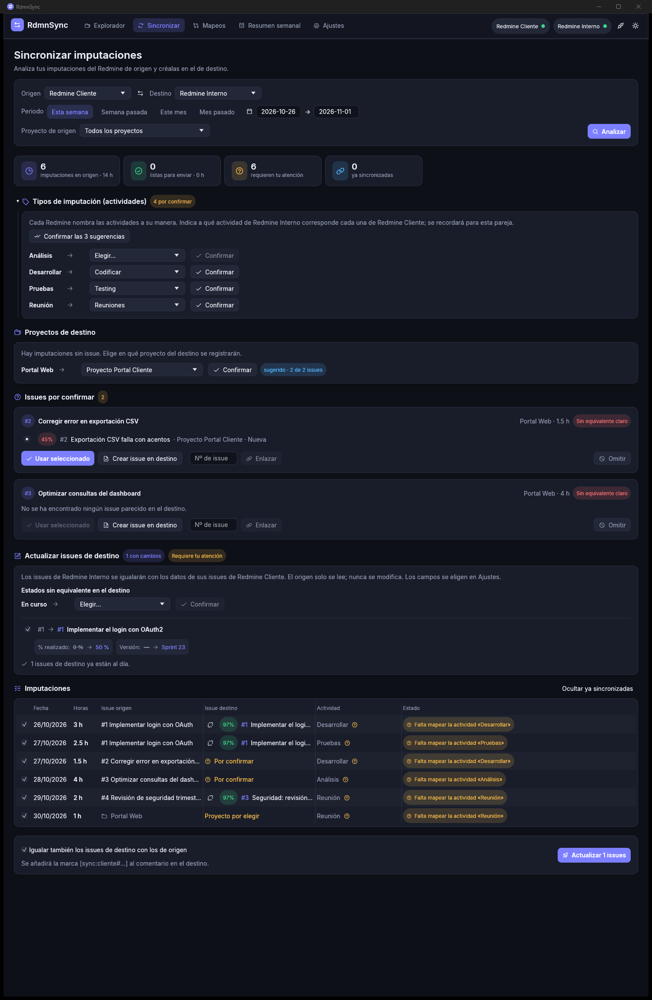
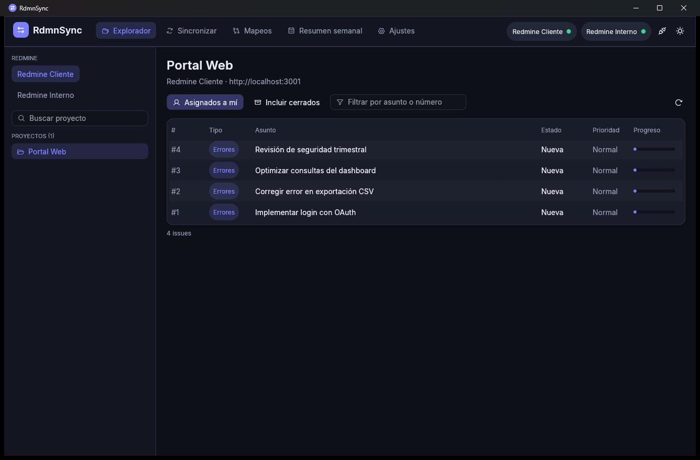
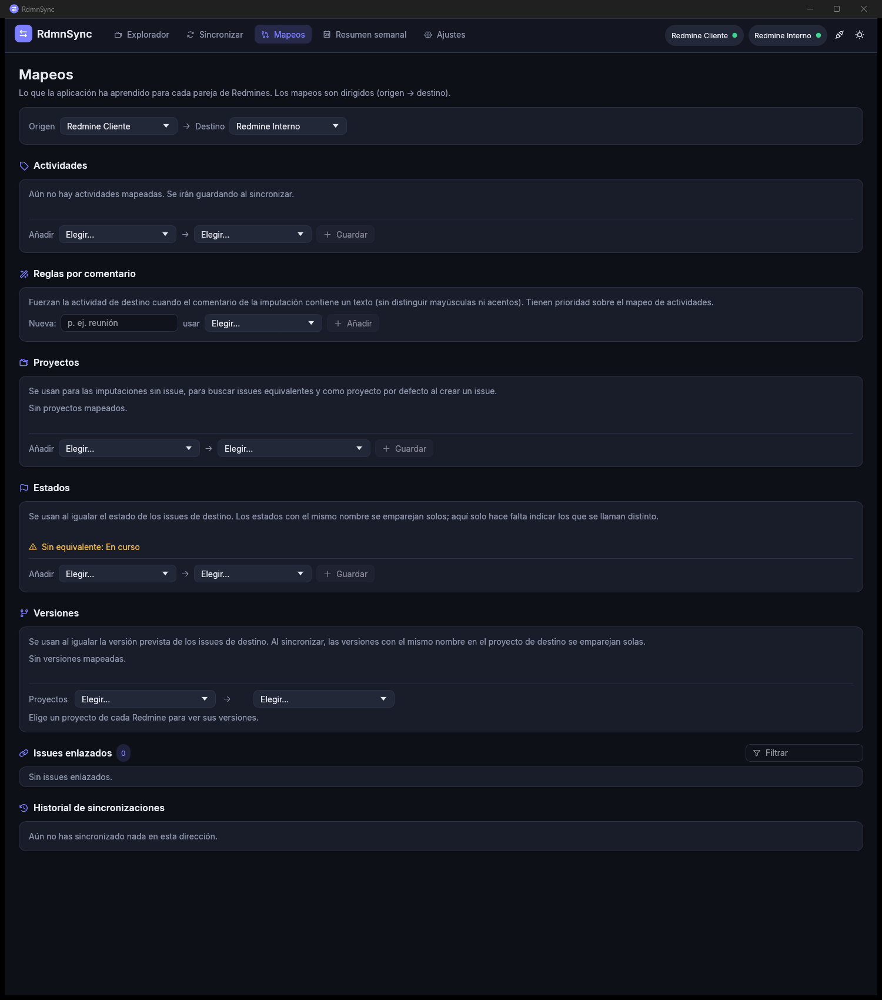
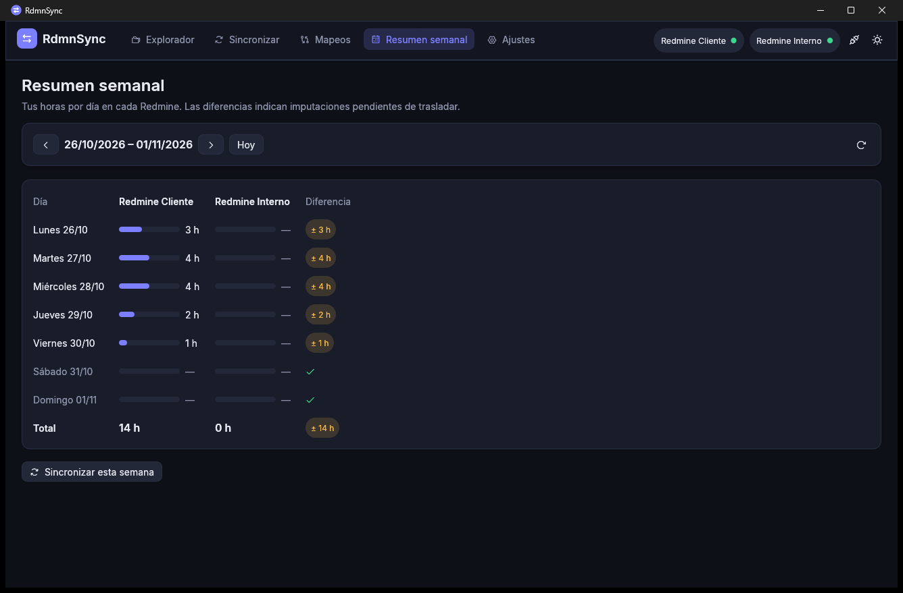

# RdmnSync

**Lleva tus imputaciones de horas de un Redmine a otro sin teclearlas dos veces.**

RdmnSync es una aplicación de escritorio para Windows y Linux que lee tus imputaciones (*time entries*)
en un Redmine de origen y las crea en un Redmine de destino. Por el camino, encuentra el issue
equivalente en el destino, traduce los tipos de imputación («Desarrollar» → «Codificar»), evita
duplicados y, si quieres, deja el issue de destino con el mismo estado, % realizado, fechas y versión
que el de origen.



> 📘 **¿Primera vez?** Consulta el [manual de uso](MANUAL.md): explica paso a paso cada pantalla y
> qué hacer ante cada situación.

---

## Índice

- [Por qué existe](#por-qué-existe)
- [Características](#características)
- [Descarga e instalación](#descarga-e-instalación)
- [Inicio rápido](#inicio-rápido)
- [Cómo funciona por dentro](#cómo-funciona-por-dentro)
- [Seguridad y privacidad](#seguridad-y-privacidad)
- [Compilar desde el código](#compilar-desde-el-código)
- [Entorno de pruebas](#entorno-de-pruebas)
- [Estructura del proyecto](#estructura-del-proyecto)
- [Limitaciones conocidas](#limitaciones-conocidas)
- [Hoja de ruta](#hoja-de-ruta)
- [Licencias](#licencias)

---

## Por qué existe

Es habitual trabajar para un cliente que tiene su propio Redmine mientras tu empresa lleva el control
de horas en otro. Cada semana hay que imputar lo mismo dos veces, buscar a mano qué issue corresponde
a cuál y recordar que lo que en un sitio se llama «Desarrollar» en el otro es «Codificar».

RdmnSync automatiza ese trabajo y **pregunta solo cuando no está seguro**. Lo que le confirmas lo
recuerda para la próxima vez, de modo que con el uso cada sincronización requiere menos intervención.

## Características

### Conexiones
- Pide las **API keys** de cada Redmine antes de hacer nada y valida la conexión al momento.
- Puede **recordar las claves** en el almacén seguro del sistema (Administrador de credenciales de
  Windows o Secret Service en Linux). Nunca se guardan en texto plano.
- Admite tantos Redmines como necesites; la sincronización se hace siempre entre una pareja
  **origen → destino**.

### Explorador
- Tus proyectos, con jerarquía de subproyectos y buscador.
- Issues asignados a ti (o todos), abiertos o también cerrados, con filtro por asunto o número.
- Detalle completo del issue: atributos, campos personalizados, descripción, progreso e
  imputaciones con su total.



### Sincronización
- Lee **tus** imputaciones del origen en el periodo elegido (esta semana, la pasada, este mes, el
  pasado o un rango libre) y, opcionalmente, solo de un proyecto.
- **Emparejamiento automático de issues** con nivel de confianza:
  - Referencia explícita (la URL de un issue en la descripción del otro) → 100 %.
  - Similitud del asunto tolerante a acentos, mayúsculas, plurales y variantes (`OAuth` ≈ `OAuth2`),
    con bonificación por proyecto mapeado y por estar asignado a ti.
  - Por encima del 92 % se enlaza solo; entre el 55 % y el 92 % **te pregunta** mostrando
    candidatos; por debajo te propone **crear el issue** en el destino. Ambos umbrales son ajustables.
- **Creación de issues** en el destino con los datos más parecidos posible al de origen: tipo,
  prioridad, asunto, descripción, fechas, estimación, % realizado y campos personalizados que
  coincidan por nombre. Añade un enlace al origen para reconocerlo automáticamente en el futuro.
- **Tipos de imputación (actividades)**: si se llaman igual se mapean solos; si no, la app sugiere el
  más probable (conoce sinónimos habituales en español e inglés) y **siempre pide confirmación**.
- **Sin duplicados**, con tres mecanismos complementarios:
  1. Marca `[sync:<origen>#<id>]` en el comentario de la imputación creada (solo en el destino).
  2. Historial local de todo lo enviado.
  3. Detección de imputaciones que ya existen en el destino con el mismo día, horas e issue.
- **Igualar issues de destino** (activado por defecto): el issue de destino recibe estado,
  % realizado, fechas, estimación y versión del de origen. El origen **solo se lee**, nunca se
  modifica. Verás los cambios campo a campo antes de aplicarlos.

### Mapeos y memoria
- Todo lo que confirmas queda guardado **por pareja de Redmines y en una dirección concreta**:
  actividades, proyectos, issues, estados, versiones, tipos y prioridades.
- **Reglas por comentario**: «si el comentario contiene *reunión*, usar la actividad *Reuniones*».
- **Sugerencias de proyecto** deducidas de los issues que ya has enlazado.
- **Historial con deshacer**: borra del destino todas las imputaciones creadas en un envío concreto.



### Resumen semanal
- Horas por día en cada Redmine conectado, con la diferencia resaltada, para ver de un vistazo qué
  falta por trasladar. Un botón te lleva a sincronizar esa semana.



### Otros
- Tema oscuro y claro, tipografía Inter e iconos Phosphor.
- Binario único y autocontenido: ~9 MB en Windows y ~12 MB en Linux, sin instalador.

## Descarga e instalación

Descarga el binario de tu sistema desde la
[última release](https://github.com/lunasvalle02-design/RdmnSyncV2/releases/latest).

| Sistema | Fichero | Requisitos |
|---|---|---|
| Windows 10/11 (64 bits) | `rdmnsync-windows-x64.exe` | Ninguno |
| Linux (64 bits) | `rdmnsync-linux-x64` | glibc ≥ 2.35 (Ubuntu 22.04+, Debian 12+, Fedora 36+…), escritorio X11 o Wayland con OpenGL |

**Windows**: ejecuta el `.exe`. Como el binario no está firmado, SmartScreen puede mostrar
«Windows protegió su PC»; pulsa *Más información → Ejecutar de todas formas*.

**Linux**:

```sh
chmod +x rdmnsync-linux-x64
./rdmnsync-linux-x64
```

Para que la app pueda **recordar** las API keys en Linux hace falta un servicio de secretos activo
(GNOME Keyring, KWallet…). Sin él la app funciona igual, pero tendrás que introducir las claves en
cada arranque.

## Inicio rápido

1. **Obtén tu API key** en cada Redmine: *Mi cuenta → Clave de acceso a la API → Mostrar*. Si no
   aparece, pide al administrador que active *Administración → Configuración → API → Activar
   servicio web REST*.
2. **Abre RdmnSync** y añade cada Redmine con un nombre, su URL y tu API key.
3. Pulsa **Continuar** y ve a **Sincronizar**.
4. Elige **origen**, **destino** y **periodo**, y pulsa **Analizar**.
5. Resuelve lo que te pregunte (actividades, issues dudosos, proyectos) y revisa la tabla.
6. Pulsa el botón de envío («Crear N imputaciones…»). Listo.

El [manual](MANUAL.md) detalla cada paso.

## Cómo funciona por dentro

```
Origen (solo lectura)                         Destino (escritura)
──────────────────────                        ─────────────────────
time_entries?user_id=me  ─┐
issues?issue_id=…         │   ┌──────────────┐   POST /time_entries
                          ├──►│  Plan        │──►PUT  /issues/:id (igualar)
issues asignados / del  ──┘   │  · issues    │   POST /issues (crear)
proyecto mapeado / búsqueda   │  · activid.  │
por palabra clave             │  · proyectos │◄── mapeos guardados
                              │  · duplicados│◄── historial local
                              └──────────────┘
```

1. **Carga**: imputaciones del usuario en el origen para el periodo, sus issues, tus imputaciones en
   el destino para el mismo periodo (para detectar duplicados) y un conjunto de issues candidatos del
   destino (asignados a ti, de los proyectos mapeados, los ya enlazados y los encontrados buscando la
   palabra más representativa de cada asunto).
2. **Plan**: para cada issue de origen se puntúan los candidatos; para cada actividad se busca su
   equivalente; se detectan imputaciones ya sincronizadas o duplicadas.
3. **Resolución**: tú confirmas lo dudoso. Cada confirmación se guarda.
4. **Envío**: se crean las imputaciones resolviendo el id de actividad **en el proyecto de destino**
   (cada proyecto puede tener su propio juego de actividades). Después se igualan los issues de
   destino y se vuelven a leer para avisar de cualquier campo que Redmine no haya aplicado.

## Seguridad y privacidad

- Las API keys **solo** viajan a la URL del Redmine al que pertenecen (por HTTPS si la URL lo usa).
- Si marcas *Recordar*, se guardan en el almacén de credenciales del sistema operativo.
- Los mapeos y el historial se guardan en un JSON legible en tu perfil:
  - Windows: `%APPDATA%\RdmnSync\RdmnSync\config\rdmnsync.json`
  - Linux: `~/.config/rdmnsync/rdmnsync.json`
- Se usan los certificados raíz del sistema (útil con CAs corporativas) y se respetan las variables
  `HTTPS_PROXY`, `HTTP_PROXY` y `NO_PROXY`.
- La opción «Aceptar certificados no válidos» existe para redes internas con certificados
  autofirmados; úsala solo si confías en la red.
- El Redmine de origen **nunca se modifica**.

## Compilar desde el código

Solo necesitas **Docker**; no hace falta instalar Rust ni toolchains de compilación cruzada.

```sh
sh scripts/build.sh          # Linux, macOS o Git Bash
scripts\build.ps1            # PowerShell
```

El script construye la imagen `rdmnsync-builder` (Rust + mingw-w64), ejecuta los tests y deja en
`dist/`:

- `rdmnsync-windows-x64.exe` (objetivo `x86_64-pc-windows-gnu`)
- `rdmnsync-linux-x64` (objetivo `x86_64-unknown-linux-gnu`)

Para comandos sueltos de cargo dentro del contenedor:

```sh
scripts/cargo.sh check --target x86_64-pc-windows-gnu
scripts/cargo.sh test  --target x86_64-unknown-linux-gnu
```

Las dependencias y los artefactos se guardan en los volúmenes de Docker `rdmnsync-cargo-registry` y
`rdmnsync-target`, por lo que las compilaciones posteriores son incrementales.

## Entorno de pruebas

`docker/test-redmines` levanta dos Redmine 6 con SQLite y datos que reproducen los casos difíciles:
actividades con nombres distintos, un estado renombrado, versiones, issues con asuntos parecidos pero
no idénticos y una imputación sin issue.

```sh
docker compose -f docker/test-redmines/compose.yml up -d   # http://localhost:3001 y :3002
sh docker/test-redmines/seed.sh                            # siembra e imprime las API keys
```

Tests:

```sh
# Unitarios
scripts/cargo.sh test --target x86_64-unknown-linux-gnu

# De extremo a extremo contra los Redmine de prueba
DOCKER_EXTRA="-e RDMN_A_URL=http://host.docker.internal:3001 -e RDMN_A_KEY=<clave A> \
              -e RDMN_B_URL=http://host.docker.internal:3002 -e RDMN_B_KEY=<clave B>" \
  scripts/cargo.sh test --target x86_64-unknown-linux-gnu -- --include-ignored --nocapture
```

El test `end_to_end` analiza, envía, vuelve a analizar comprobando que no se duplica nada, iguala un
issue de destino verificando que el de origen no cambia, y deja ambos Redmines como estaban.

En compilaciones *debug*, la variable `RDMNSYNC_DEV_TAB=explorer|sync|mappings|summary|settings` salta
la pantalla de conexiones (si hay dos Redmines conectados) y abre esa pestaña; útil para capturas.

## Estructura del proyecto

| Ruta | Contenido |
|---|---|
| `src/redmine/` | Cliente REST bloqueante (ureq + rustls con verificador de la plataforma) y modelos |
| `src/matching.rs` | Normalización de textos, similitud, familias de nombres, marca `[sync:…]` |
| `src/sync.rs` | Carga de datos, construcción del plan, deduplicación y envío de imputaciones |
| `src/issue_sync.rs` | Diferencias campo a campo y actualización de issues de destino |
| `src/store.rs` | Configuración, mapeos e historial (JSON) |
| `src/secrets.rs` | API keys en el almacén de credenciales del sistema |
| `src/worker.rs` | Tareas de red en hilos de fondo con mensajes a la interfaz |
| `src/theme.rs` | Paleta, tipografía y componentes visuales |
| `src/ui/` | Pantallas: conexiones, explorador, sincronizar, mapeos, resumen y ajustes |
| `docker/` | Imagen de compilación y Redmines de prueba |
| `scripts/` | Compilación y wrapper de cargo en Docker |
| `docs/img/` | Capturas usadas en la documentación |

Pila: Rust 2024, [egui/eframe](https://github.com/emilk/egui) 0.37, ureq 3, serde, keyring, strsim.

## Limitaciones conocidas

- Solo se migran las imputaciones del usuario dueño de la API key.
- La sincronización es en un solo sentido por ejecución (puedes invertir origen y destino, pero los
  mapeos de cada dirección son independientes).
- Si el destino exige campos personalizados obligatorios que ningún issue del proyecto tiene
  rellenos, hay que completarlos a mano en el diálogo de creación.
- Si un proyecto de destino tiene deshabilitada la actividad mapeada, esa imputación falla con un
  mensaje claro.
- Las versiones inexistentes en el destino no se crean automáticamente.
- Solo se igualan los issues que aparecen en las imputaciones del periodo analizado.
- Los binarios no están firmados digitalmente.

## Hoja de ruta

- Perfiles con permisos para migrar imputaciones de otros usuarios (administradores).
- Crear versiones en el destino desde la aplicación.
- Igualar cualquier issue enlazado, aunque no tenga imputaciones en el periodo.
- Exportación del historial a CSV.

## Licencias

- Código: MIT (declarada en `Cargo.toml`).
- Tipografía [Inter](https://rsms.me/inter/): SIL Open Font License 1.1 (`assets/fonts/Inter-LICENSE.txt`).
- Iconos [Phosphor](https://phosphoricons.com/): MIT.
